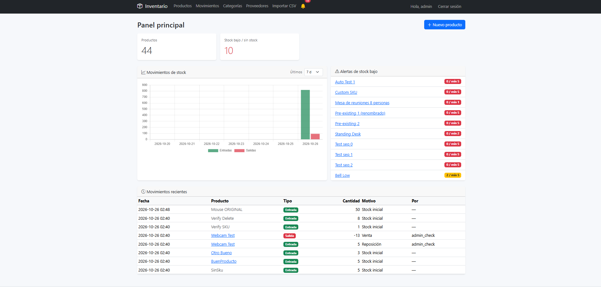
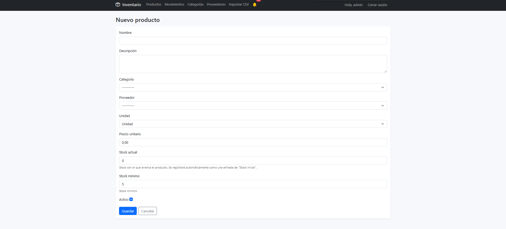
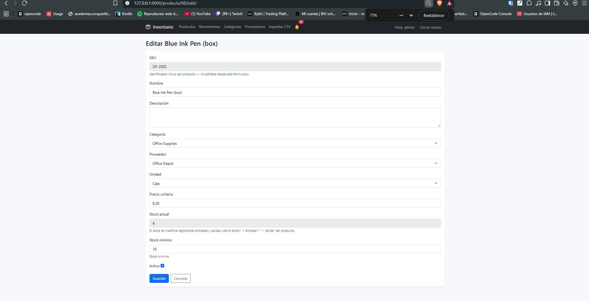

# Sistema de Inventario

Aplicación web para controlar stock y movimientos de productos. Construida con
**Django 5** + **SQLite** (desarrollo) / **PostgreSQL** (producción) + **Bootstrap 5**.

Permite registrar entradas y salidas de stock, recibir alertas cuando un
producto baja de su umbral mínimo, filtrar el catálogo por proveedor o
categoría, importar productos en bulk desde CSV y visualizar la evolución del
inventario en gráficos.

---

## Índice

1. [Instalación](#instalación)
2. [Acceso y estructura de la app](#acceso-y-estructura-de-la-app)
3. [Crear, editar y eliminar un producto](#crear-editar-y-eliminar-un-producto)
4. [Registrar entradas y salidas de stock](#registrar-entradas-y-salidas-de-stock)
5. [Alertas de stock mínimo](#alertas-de-stock-mínimo)
6. [Administrar proveedores](#administrar-proveedores)
7. [Administrar categorías](#administrar-categorías)
8. [Importar un archivo CSV](#importar-un-archivo-csv)
9. [Panel y gráficos](#panel-y-gráficos)
10. [Referencia técnica](#referencia-técnica)

---

## Instalación

### Requisitos

- Python 3.11 o superior
- Git (opcional)

### Pasos

```bash
# 1. Crear el entorno virtual
python -m venv .venv

# 2. Activarlo
#    Windows PowerShell:
.\.venv\Scripts\Activate.ps1
#    Linux / macOS:
source .venv/bin/activate

# 3. Instalar las dependencias
pip install -r requirements.txt

# 4. Crear las tablas en la base de datos
python manage.py migrate

# 5. (Opcional) Cargar datos de ejemplo
python manage.py seed_demo

# 6. Crear el usuario administrador
python manage.py createsuperuser

# 7. Arrancar el servidor
python manage.py runserver
```

Abre <http://127.0.0.1:8000/> en el navegador.

### Datos de ejemplo

`python manage.py seed_demo` carga 3 categorías, 3 proveedores, 7 productos y
sus movimientos iniciales. Los datos están elegidos a propósito para que se
vean los tres estados de stock en acción:

| Producto | Stock | Mínimo | Estado |
|---|---|---|---|
| Wireless Mouse | 45 | 10 | OK |
| 27" Monitor | 8 | 5 | OK |
| Mechanical Keyboard | 3 | 5 | **BAJO** |
| A4 Paper Ream | 60 | 20 | OK |
| Blue Ink Pen (box) | 4 | 10 | **BAJO** |
| Office Chair | 12 | 4 | OK |
| Standing Desk | 0 | 2 | **AGOTADO** |

---

## Acceso y estructura de la app

La aplicación es **completamente privada**: todo excepto la pantalla de login
requiere una sesión activa.



| Pantalla | Ruta | Qué hace |
|---|---|---|
| Panel | `/` | KPIs, gráfico de movimientos, alertas de stock bajo |
| Productos | `/products/` | Listado con filtros por proveedor, categoría y búsqueda |
| Nuevo producto | `/products/new/` | Alta de producto con SKU y stock automáticos |
| Movimientos | `/movements/` | Auditoría completa de entradas y salidas |
| Categorías | `/categories/` | Listado y alta de categorías |
| Proveedores | `/suppliers/` | Listado y alta de proveedores |
| Importar CSV | `/import/` | Carga masiva de productos |
| Iniciar sesión | `/login/` | Acceso a la aplicación |
| Administrador | `/admin/` | Panel de administración de Django |

La **campana** 🔔 en la navbar muestra la cantidad de productos con stock
bajo. El número está en rojo si hay productos agotados y en amarillo si
solo hay stock bajo. Es un enlace directo al panel de alertas.

---

## Crear, editar y eliminar un producto

### Crear un producto

Desde **Productos → Nuevo producto** (o el botón `+` en la navbar).



**Tres cosas que hace el sistema automáticamente:**

1. **El SKU se genera solo.** No se escribe. Se arma con un prefijo de la
   categoría + un correlativo de 4 dígitos: `EL-0001`, `EL-0002`, `OF-0001`…
   Los prefijos por categoría se configuran en
   `inventory/services.py` → `CATEGORY_PREFIXES`. Si la categoría no está
   mapeada, se usa el prefijo genérico `GEN-`.

2. **El stock inicial queda registrado en el log.** Si cargas 30 unidades al
   crear el producto, se crea automáticamente un movimiento de tipo
   *Entrada* con motivo `Stock inicial`. Así el histórico nunca tiene
   "stock mágico" sin origen.

3. **El mensaje de confirmación muestra el SKU asignado:**
   *"Producto "Mouse inalámbrico" creado con SKU EL-0012."*

### Editar un producto

Desde el listado, click en el nombre del producto → **Editar**.



**El SKU y el stock no se pueden editar a mano.** Los dos aparecen
read-only (bloqueados) por dos razones distintas:

- **El stock se cambia registrando movimientos.** Si pones 30 en el campo a
  mano, el producto queda con 30 unidades que no aparecen en ningún
  movimiento del log, y el balance de existencias queda desbalanceado.

El **stock mínimo** sí se edita: es la referencia contra la que se dispara
la alerta.

### Eliminar un producto

Desde la página del producto, botón **Eliminar** (con confirmación).

**Al eliminar un producto con stock, el sistema registra la salida
automáticamente:**

Concretamente:

1. Se crea un movimiento de tipo **Salida** con la cantidad que tenía el
   producto y motivo `Producto eliminado`.
2. Se borra el producto.

El movimiento **sobrevive** al borrado (guarda un snapshot del SKU y del
nombre), así que el log de auditoría sigue mostrando qué producto era:

```
Fecha       Producto            Tipo    Cantidad  Motivo
────────────────────────────────────────────────────────────────
2026-10-26  Mouse inalámbrico    Salida       -30   Producto eliminado
            EL-0012
```

---

## Registrar entradas y salidas de stock

El stock **solo** cambia desde la página de un producto, con los botones
**+ Entrada** (verde) y **− Salida** (rojo).

### Registrar una entrada

Click en **+ Entrada** → se abre el formulario con el tipo ya preseleccionado.

```
┌──────────────────────────────────────────────────────────────┐
│  Movimiento de stock para Mouse inalámbrico                  │
│  (stock actual: 30)                                          │
├──────────────────────────────────────────────────────────────┤
│  Tipo de movimiento   [ Entrada (compra / devolución)  ▾ ]   │
│  Cantidad             [ 20                               ]   │
│  Motivo               [ Compra factura 0042              ]   │
│  Referencia           [ FAC-0042                         ]   │
│  Proveedor            [ TechSource                     ▾ ]   │
│                                                              │
│  [ Guardar movimiento ]  [ Cancelar ]                        │
└──────────────────────────────────────────────────────────────┘
```

- **Tipo**: `Entrada`, `Salida` o `Ajuste`.
- **Cantidad**: siempre positiva — el signo lo da el tipo.
- **Motivo**: texto libre para contexto ("Venta mostrador", "Devolución").
- **Referencia**: número de factura, orden de compra, etc.
- **Proveedor**: opcional, útil para las entradas.

Después de guardar, vuelves a la ficha del producto y el stock quedó
actualizado (30 → 50).

### Registrar una salida

Click en **− Salida**. El formulario es el mismo, con el tipo preseleccionado
como *Salida*.

**No podés sacar más stock del que tenés.** Si intentás retirar 99 unidades
de un producto con 2, el sistema lo rechaza y te muestra el error en el
formulario:

```
No se pudo registrar el movimiento: quantity: No se pueden retirar 99
unidades. Solo 2 disponibles para EL-0012.
```

El mensaje aparece en el form (no como error 500) para que puedas corregir
el número y reintentar.

---

## Alertas de stock mínimo

Cada producto tiene un **stock mínimo**. Cuando el stock llega a ese valor
(o baja), el sistema avisa.

### Dónde se ven las alertas

**1. En la navbar** — la campana 🔔 con el número de productos en alerta:

```
🔔 4        ← 4 productos con stock bajo
```

En rojo si hay agotados, en amarillo si solo hay stock bajo. La campana
pulsa (animación CSS) cuando hay productos agotados, para que la attracta
más atención.

**2. En el panel**, en el card "Alertas de stock bajo":

```
┌──────────────────────────────────────────────────────────────┐
│  ⚠️  Alertas de stock bajo                                   |
├──────────────────────────────────────────────────────────────┤
│  Standing Desk                          0 / mín 2  [AGOTADO] │
│  Mechanical Keyboard                    3 / mín 5  [BAJO]    │
│  Hub USB-C 7 puertos                    4 / mín 5  [BAJO]    │
│  Lapicero azul BIC caja                12 / mín 15 [BAJO]    │
└──────────────────────────────────────────────────────────────┘
```

Los agotados aparecen primero (son más urgentes), y después los que están
bajo el mínimo ordenados de menor a mayor stock.

**3. En el listado de productos**, cada fila tiene una columna "Estado":

```
SKU      Nombre                 Stock     Estado
────────────────────────────────────────────────────
EL-1001  Wireless Mouse         45 / 10   [ OK ]
EL-1003  Mechanical Keyboard     3 / 5    [ BAJO ]
FU-3002  Standing Desk           0 / 2   [ AGOTADO ]
```

**4. Al momento de hacer una salida**, si esa salida cruza el umbral, sale
un aviso:

```
⚠️ "Mechanical Keyboard" quedó en 3 unidades (mínimo 5).
```

Este aviso sale **solo en la transición** (en el momento de cruzar el
umbral), no en cada salida. Si más tarde bajás más stock, no vuelve a
avisar — el producto ya figura en la lista de alertas.

### Regla del umbral

La alerta se dispara con `stock <= stock mínimo` (menor **o igual**). Es
decir: un producto con mínimo 5 avisa cuando tiene 5, 4, 3, 2, 1 o 0.

---

## Administrar proveedores

### Listado

**Proveedores** en la navbar.

```
┌──────────────────────────────────────────────────────────────┐
│  Nombre         Contacto      Email              Productos   │
├──────────────────────────────────────────────────────────────┤
│  Comfort Living  Júlia Pérez   julia@...example       2      │
│  Office Depot    Mark Chen     mark@...example       2       │
│  TechSource      Anna Lee      anna@...example       3       │
└──────────────────────────────────────────────────────────────┘
```

### Crear un proveedor

**Proveedores → Nuevo proveedor**.

```
┌──────────────────────────────────────────────────────────────┐
│  Nuevo proveedor                                             │
├──────────────────────────────────────────────────────────────┤
│  Nombre             [ Global Supply Ltd                ]     │
│  Notas              [ Proveedor principal de imports   ]     │
│  ☑ Activo                                                    │
│                                                              │
│  [ Guardar ]  [ Cancelar ]                                   │
└──────────────────────────────────────────────────────────────┘
```

### Editar un proveedor

Desde el listado, click en el **lápiz** de la fila, o entrá a la ficha del
proveedor y click en **Editar**.

### Ver la ficha de un proveedor

Click en el nombre del proveedor. Ves:

- **Los productos** que provee (con su stock actual).
- **Los movimientos** de stock asociados a ese proveedor.
- Botón para **editar** el proveedor.

### Eliminar un proveedor

**No hay botón de eliminar en la UI.** La razón es que el proveedor está
relacionado con productos y con movimientos:

- Los **productos** quedan sin proveedor (`SET_NULL`) — no se borran.
- Los **movimientos** quedan sin proveedor (`SET_NULL`) — el log se conserva.

Si un proveedor ya no se usa, la forma de "retirarlo" es desactivarlo
(`Activo` → off). Followso aparece en el listado pero no se puede elegir en
los formularios de producto ni en la importación CSV.

> **Nota:** el borrado directo desde el admin de Django
> (`/admin/inventory/supplier/`) también funciona, y aplica las mismas
> reglas `SET_NULL`.

---

## Administrar categorías

### Listado

**Categorías** en la navbar. Cada categoría se muestra como una tarjeta:

```
┌──────────────────┐  ┌──────────────────┐  ┌──────────────────┐
│ Electrónica      │  │ Muebles          │  │ Oficina          │
│ Phones, laptops… │  │ Chairs, desks…   │  │ Paper, pens…     │
│ [3 productos]    │  │ [2 productos]    │  │ [2 productos]    │
└──────────────────┘  └──────────────────┘  └──────────────────┘
```

### Crear una categoría

**Categorías → Nueva categoría**.

```
┌──────────────────────────────────────────────────────────────┐
│  Nueva categoría                                             │
├──────────────────────────────────────────────────────────────┤
│  Nombre          [ Electrónica                       ]       |
│  Descripción     [ Phones, laptops, periféricos      ]       │
│                                                              │
│  [ Guardar ]  [ Cancelar ]                                   │
└──────────────────────────────────────────────────────────────┘
```

### Editar y eliminar

- **Editar**: no hay botón directo en la tarjeta. Entrá a la ficha de la
  categoría (click en el nombre) y usá el formulario de edición, o el admin
  de Django.
- **Eliminar**: botón **Eliminar** en la ficha de la categoría, con
  confirmación.

**Una categoría con productos NO se puede eliminar.** La relación está
protegida (`PROTECT`) a propósito: forzar el borrado dejaría productos
huérfanos sin categoría, y la primera cosa que hacés al abrir el listado
de productos es filtrar por categoría.

Si querés eliminar una categoría que tiene productos, primero tenés que
reasignar esos productos a otra categoría (desde la ficha de cada producto)
o eliminarlos.

---

## Importar un archivo CSV

**Importar CSV** en la navbar.

### Formato del archivo

La columna `sku` es **opcional**. Las obligatorias son `sku` (o vacía),
`name`, `category`, `quantity` y `minimum_stock`.

```csv
sku,name,category,supplier,quantity,minimum_stock,unit,unit_price
EL-2001,Webcam HD,Electronics,TechSource,15,5,unidad,39.99
OF-2001,Engrapadora,Office Supplies,Office Depot,30,10,unidad,12.00
,Lámpara LED,Furniture,Comfort Living,0,2,unidad,29.50
```

| Columna | ¿Obligatoria? | Qué hace |
|---|---|---|
| `sku` | No | Si viene vacío, se genera uno. Si ya existe, se actualiza ese producto. |
| `name` | Sí | Nombre del producto. |
| `category` | Sí | Nombre de la categoría. **Se crea si no existe.** |
| `quantity` | Sí | Stock inicial. **Solo se aplica si el producto es nuevo.** Ver nota abajo. |
| `minimum_stock` | Sí | Umbral de alerta. |
| `supplier` | No | Nombre del proveedor. **Se crea si no existe.** |
| `unit` | No | `unidad`, `caja`, `kg`, `g`, `L`, `m`. Default: `unidad`. |
| `unit_price` | No | Default: `0.00`. |
| `description` | No | Descripción libre. |
| `is_active` | No | `true`/`false`. Default: `true`. |

> ### ⚠️ El stock solo se aplica al crear el producto
>
> La columna `quantity` define el stock **inicial** de un producto
> **nuevo**. Si el producto ya existe (mismo SKU), su stock **no se
> toca** — el valor del CSV se ignora.
>
> **Por qué:** el stock real es información operacional (lo que hay en el
> depósito). Se cambia registrando entradas y salidas, no importando un
> catálogo. Si el importador lo pisara, el log de auditoría quedaría
> desalineado: el producto tendría 7 unidades pero su único movimiento
> diría *"entrada de 50"*.
>
> | | Producto nuevo | Producto existente |
> |---|---|---|
> | `quantity` del CSV | Se aplica ✅ | **Se ignora** ⚠️ |
> | `name`, `description`, `category`, `supplier`, `unit`, `unit_price`, `minimum_stock`, `is_active` | Se aplican ✅ | Se actualizan ✅ |
> | Movimientos de stock | Se crea el IN de "Stock inicial" | No se tocan ✅ |
>
> Para cambiar el stock de un producto existente, usá la ficha del
> producto y registrá una entrada o salida.


### Cargar el archivo

```
┌──────────────────────────────────────────────────────────────┐
│  Importar productos desde CSV                                │
├──────────────────────────────────────────────────────────────┤
│  Archivo CSV                                                 │
│  ┌────────────────────────────────────────────────────────┐  │
│  │  sample_products.csv                                   │  │
│  └────────────────────────────────────────────────────────┘  │
│  Columnas obligatorias: sku, name, category, quantity,       │
│  minimum_stock. Opcionales: supplier, description, unit,     │
│  unit_price, is_active.                                      │
│                                                              │
│  [ ⬆ Subir archivo ]                                         │
│                                                              │
│  ─────────────────────────────────────────────────────────   │
│  CSV de ejemplo                                              │
│  sku,name,category,quantity,minimum_stock                    │
│  EL-9999,Webcam HD,Electronics,15,5                          │
│  ,Engrapadora,Office Supplies,30,10                          │
└──────────────────────────────────────────────────────────────┘
```

### Qué pasa con cada fila

| Situación | Resultado |
|---|---|
| Producto con SKU nuevo | Se **crea** ✅ (con el stock del CSV) |
| Producto con SKU que ya existe | Se **actualizan** sus datos de catálogo. **El stock no se toca** ⚠️ |
| Producto con SKU vacío | Se genera un SKU correlativo ✅ |
| Producto con SKU vacío, mismo nombre y categoría que uno existente | Se actualiza el existente ✅ |
| Categoría que no existe | **Se crea automáticamente** ✅ |
| Proveedor que no existe | **Se crea automáticamente** ✅ |
| Fila con un error (número inválido, categoría vacía) | Se **omite** y se reporta el error ✅ |

**Reimportar el mismo archivo es idempotente**: no se crean duplicados ni
se multiplican los movimientos de stock. Es el flujo normal cuando corregís
un dato del CSV y lo volvés a subir.

> **Ojo con la columna `category`:** como las categorías se crean
> automáticamente a partir del nombre, un typo genera una categoría basura
> y mueve todos los productos de ese archivo a ella. Revisá la columna
> antes de importar.

### Resultado de la importación

```
┌──────────────────────────────────────────────────────────────┐
│  Resultado de la importación                                 │
├──────────────────────────────────────────────────────────────┤
│  Creados: 12 · Actualizados: 3 · Omitidos: 1                 │
│                                                              │
│  Productos actualizados                                      │
│  ┌──────┬──────────────────┐                                 │
│  │ Fila │ SKU              │                                 │
│  ├──────┼──────────────────┤                                 │
│  │    3 │ EL-1001          │                                 │
│  │    7 │ OF-2001          │                                 │
│  └──────┴──────────────────┘                                 │
│  ℹ️  Estos SKUs ya existían en la base, así que se actualizó │
│     el producto existente con los datos del archivo. No se   │
│     crearon duplicados.                                      │
│                                                              │
│  Errores por fila                                            │
│  ┌──────┬──────────────────────────────────────────────┐     │
│  │ Fila │ Mensaje                                      │     │
│  ├──────┼──────────────────────────────────────────────┤     │
│  │   12 │ Valor numérico inválido: [<class 'decimal…'] │     │
│  └──────┴──────────────────────────────────────────────┘     │
└──────────────────────────────────────────────────────────────┘
```

**Los errores no detienen la importación.** Cada fila se procesa de forma
independiente: las válidas se importan, las que fallan se omiten y se
reportan con el número de fila y el motivo. Podés corregir el archivo y
volver a subirlo sin perder el trabajo de las filas que sí importaron.

### Archivo de ejemplo

El repositorio incluye `inventory/sample_products.csv` con 15 productos que
cubren todos los casos: stock normal, stock bajo, agotado, producto
inactivo, SKU vacío, acentos y caracteres especiales.

---

## Panel y gráficos

**Panel** (`/`).

```
┌────────────┬────────────┬────────────┬────────────┐
│ Productos  │ Categorías │ Proveedores│ Stock bajo │
│    46      │     11     │     9      │     4      │
└────────────┴────────────┴────────────┴────────────┘
```

Debajo, dos paneles:

- **Gráfico de movimientos** (Chart.js) — barras de entradas vs salidas por
  día. El período se cambia desde el selector (7, 15, 30, 60 o 90 días).
- **Alertas de stock bajo** — la lista de productos que necesitan reposición.

Y abajo, la tabla de **movimientos recientes** con los últimos 8
movimientos registrados.

---

## Referencia técnica

### Estructura del proyecto

```
proyecto2/
├─ manage.py
├─ requirements.txt
├─ render.yaml                  ← Blueprint de deploy para Render
├─ inventory_system/            ← Configuración del proyecto Django
│  ├─ settings.py
│  └─ urls.py
└─ inventory/                   ← La aplicación
   ├─ models.py                 ← Category, Supplier, Product, StockMovement
   ├─ services.py               ← Lógica de negocio (stock, SKU, CSV)
   ├─ views.py                  ← Vistas
   ├─ forms.py                  ← Formularios
   ├─ admin.py                  ← Panel de administración
   ├─ middleware.py             ← Exige autenticación en todas las rutas
   ├─ context_processors.py     ← Badge de alertas en la navbar
   ├─ urls.py
   ├─ management/commands/
   │  └─ seed_demo.py           ← Datos de ejemplo
   ├─ migrations/
   ├─ templates/inventory/      ← 12 templates
   └─ static/inventory/style.css
```

### Modelo de datos

```
Category 1 ── n Product n ── 1 Supplier
Product 1 ── n StockMovement
StockMovement n ── 1 Supplier (opcional)
```

| Modelo | Campos clave | Relaciones |
|---|---|---|
| `Category` | `name` (único) | `productos` |
| `Supplier` | `name`, `notes`, `is_active` | `proveedores`, `movimientos_proveedor` |
| `Product` | `sku` (único), `name`, `quantity`, `minimum_stock`, `unit_price` | `categoria`, `proveedor`, `movimientos` |
| `StockMovement` | `movement_type` (IN/OUT/ADJ), `quantity`, `reason`, `reference` | `producto`, `proveedor`, `usuario` |

### Reglas de negocio

| Regla | Dónde vive |
|---|---|
| El SKU se genera automáticamente si viene vacío | `Product.save()` → `services.generate_next_sku()` |
| El stock inicial genera un movimiento IN | `Product.save()` |
| Eliminar un producto genera un movimiento OUT | `Product.delete()` |
| El stock nunca se edita a mano, solo con movimientos | `ProductForm` (campo `disabled`) |
| Un CSV nunca pisa el stock de un producto existente | `services._import_one_row()` |
| No se puede sacar más stock del que hay | `services.record_movement()` + `StockMovement.clean()` |
| El log de movimientos es append-only | `StockMovement` (no se borra) |
| Reimportar un CSV no crea duplicados | `services._resolve_sku_for_import()` |
| Toda la app exige sesión salvo `/login/` | `inventory.middleware.RequireLoginMiddleware` |

### Variables de entorno

| Variable | Default | Para qué sirve |
|---|---|---|
| `DJANGO_SECRET_KEY` | valor inseguro de dev | Clave criptográfica |
| `DJANGO_DEBUG` | `True` | `False` en producción |
| `ALLOWED_HOSTS` | `localhost,127.0.0.1,[::1],testserver` | Hosts permitidos (lista separada por comas) |
| `DATABASE_URL` | — | Si está, se usa Postgres; si no, SQLite |
| `SECURE_HSTS_SECONDS` | `0` | HSTS en producción (activar con `31536000`) |

### Deploy en Render

El repositorio incluye `render.yaml` con toda la infraestructura declarada
como código: base de datos PostgreSQL, web service con gunicorn, variables de
entorno y migraciones automáticas.

```bash
git add . && git commit -m "Deploy" && git push
```

Después, en el dashboard de Render: **New → Blueprint** → elegí el repo.
Render crea la base, compila, corre las migraciones y levanta el servicio.

Para crear el usuario administrador, usá la **Shell** del servicio en
Render:

```bash
python manage.py createsuperuser
python manage.py seed_demo    # opcional
```

### Comandos útiles

| Comando | Qué hace |
|---|---|
| `python manage.py runserver` | Servidor de desarrollo |
| `python manage.py migrate` | Aplica las migraciones |
| `python manage.py makemigrations` | Genera migraciones tras cambiar los modelos |
| `python manage.py seed_demo` | Carga datos de ejemplo |
| `python manage.py createsuperuser` | Crea un usuario administrador |
| `python manage.py shell` | Consola de Python con Django cargado |
| `python verify.py` | Ejecuta la suite de verificación end-to-end |

